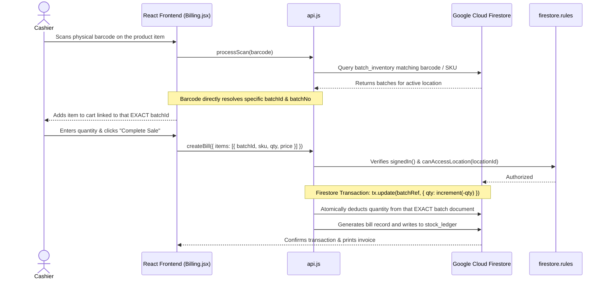
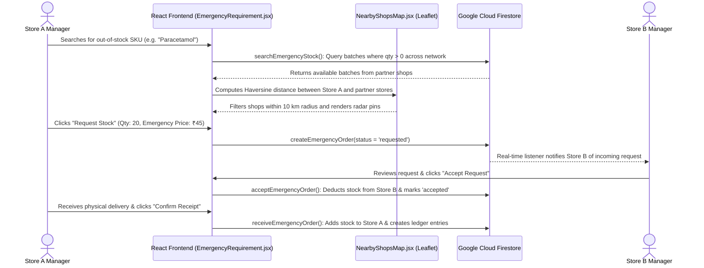

# StockFlow — Comprehensive Project & Code Architecture Guide
*A complete, step-by-step guide to explain the project architecture, algorithms, and code implementation to teachers, evaluators, and examiners.*

---

## 1. Executive Summary & Project Problem Statement

### The Real-World Problem:
In retail, pharmacy, and grocery management, traditional inventory systems suffer from three critical flaws:
1. **Mismatches Between Physical & Digital Batches**: Generic inventory systems deduct stock from arbitrary batches rather than tracking the exact physical box scanned at the checkout counter, creating severe audit discrepancies.
2. **Stockouts & Emergency Crises**: When a pharmacy or grocery runs out of a vital medicine or essential good, customers leave empty-handed, and sales are lost because nearby shops cannot communicate inventory availability securely.
3. **Lack of Role Separation**: Typical small-shop software gives everyone the same screen, leading to data tampering, accidental price edits, and cashier errors.

### The StockFlow Solution:
**StockFlow** is a cloud-native, multi-tenant inventory and POS management platform built with **React 18** and **Google Cloud Firestore**. It introduces:
- **Barcode-Driven Batch Deduction**: The exact barcode on the physical item scanned by the cashier determines precisely which batch is deducted from the database upon sale.
- **Inter-Shop Emergency Requisition Network**: Connects partner shops within a 5–20 km radius using Leaflet GPS mapping, allowing instant stock sharing with capped emergency pricing.
- **Strict Role-Based Directory Architecture**:
  - `/admin/*` — Platform Administrator (Shop onboarding, member management, platform settings).
  - `/manager/*` — Store Owner / Manager (Full analytics, approvals, AI assist, inventory control).
  - `/cashier/*` — Cashier / Counter Staff (Fast billing, barcode scanning, stock lookup, customer returns).

---

## 2. Technical Stack Overview

| Layer | Technology | Purpose / Justification |
| :--- | :--- | :--- |
| **Frontend Framework** | **React 18** (SPA) with **Vite 5** | High-performance modular UI with instant Hot Module Replacement (HMR). |
| **Routing & Protection** | **React Router DOM v6** | Strict path-based role directories (`/admin`, `/manager`, `/cashier`) with route guards. |
| **Cloud Database** | **Google Cloud Firestore** (NoSQL) | Real-time, schema-flexible document store with composite indexing and atomicity. |
| **Authentication** | **Firebase Auth** | Google OAuth 2.0 ("Continue with Google") + Email/Password registration with profile provisioning. |
| **Mapping & GIS** | **Leaflet** & **OpenStreetMap** | Interactive radar map calculating Great-Circle distances between partner locations. |
| **Hardware Scanning** | **@zxing/browser** & **Tesseract.js** | Optical barcode/QR scanner via camera + OCR for automated invoice/batch recognition. |
| **Data Visualizations** | **Recharts** | Interactive charts for inventory valuation, stock turnover, and sales trends. |
| **Security & Auditing** | **Firestore Security Rules** | Server-side cryptographic enforcement of role-based document access and immutable audit trails. |

---

## 3. Frontend Architecture (File-by-File Breakdown)

The frontend is located under `frontend/src/` and is divided into core libraries (`lib/`), reusable UI components (`components/`), and page views (`pages/`).

```
frontend/src/
├── main.jsx                     # Application entry point (DOM mount & React.StrictMode)
├── App.jsx                      # Main Router, role guards, layout shell, and directory routing
│
├── lib/
│   ├── firebase.js              # Firebase SDK initialization (Auth & Firestore instances)
│   ├── AuthContext.jsx          # User authentication state, Google OAuth & Role provisioning
│   ├── WorkspaceContext.jsx     # Active store/warehouse context & localStorage persistence
│   ├── AlertsContext.jsx        # Real-time stock alerts (low stock, expiring batches)
│   ├── ToastContext.jsx         # Global notifications (toast.ok, toast.err)
│   ├── api.js                   # Universal Firestore database CRUD operations & transactions
│   ├── fefo.js                  # Expiration date utilities and near-expiry analysis
│   ├── aiAssist.js              # Business advisory algorithms (clearance strategies, margins)
│   └── constants.js             # Enums: ROLES, SHOP_TYPES, SUBSCRIPTION_PLANS, LEDGER_REASONS
│
├── components/
│   ├── Sidebar.jsx              # Role-aware navigation sidebar (/admin, /manager, /cashier)
│   ├── TopBar.jsx               # Header bar with active warehouse switcher and user profile
│   ├── NearbyShopsMap.jsx       # Leaflet radar map calculating Haversine distances to partner stores
│   ├── BarcodeScannerModal.jsx  # Camera barcode/QR scanner using @zxing/browser
│   ├── Logo.jsx                 # Vector brand identity icon
│   └── icons.jsx                # Clean SVG icon definitions
│
└── pages/
    ├── Login.jsx                # Google OAuth sign-in + Multi-role account registration form
    ├── Dashboard.jsx            # Store KPIs, radar map of nearby partner stores, active alerts
    ├── Billing.jsx              # Counter POS with barcode scanning & direct batch deduction
    ├── Inventory.jsx            # Real-time product & batch stock lookup across warehouses
    ├── ScanAdd.jsx              # Optical camera scan to ingest new inventory batches
    ├── NearExpiry.jsx           # Proactive expiry management with automated flash discount strategies
    ├── EmergencyRequirement.jsx # Cross-shop emergency stock search, ordering, and fulfillment
    ├── Returns.jsx              # Customer return processing with auto-restock to inventory
    ├── Approvals.jsx            # Manager approval workflow for inter-warehouse stock transfers
    ├── Analytics.jsx            # Sales revenue, margin breakdown, inventory valuation charts
    ├── Reports.jsx              # Exportable CSV/Excel audit reports
    ├── Users.jsx                # Admin-only Shop Onboarding with Google Maps coordinate verification
    ├── Admin.jsx                # Admin Console for managing shops, member subscriptions, and status
    └── Settings.jsx             # User profile editing and password updates
```

---

## 4. Backend Architecture (File-by-File Breakdown)

StockFlow implements a serverless cloud architecture powered by **Google Cloud Platform (GCP)** and **Firebase Cloud Infrastructure**:

```
backend/
├── firestore.rules          # Security rules controlling database read/write permissions
├── firestore.indexes.json   # Composite index definitions for multi-field Firestore queries
├── package.json             # Backend dependencies (firebase-admin) and CLI seed scripts
└── scripts/
    ├── seedAdmin.mjs        # Script to bootstrap live project admin accounts and default locations
    ├── seedFirestore.mjs    # Seeds demo product catalog and batch inventory for testing
    └── importProductsCsv.mjs# Bulk CSV importer for product catalogs
```

### Server Configuration & Middleware:
- **`frontend/vite.config.js`**: Configures the development server and embeds an `autoExportPlugin` middleware (`/api/export-emulator`) that persists local test sessions to disk.
- **`firebase.json`**: Declares Firestore rules paths, index definitions, and emulator port bindings (Auth: `9099`, Firestore: `8080`, UI: `4000`).

---

## 5. Database Architecture & Schema (Cloud Firestore)

Google Cloud Firestore is a NoSQL document database. StockFlow structures its data across 8 primary collections:

```
├── users/                # Collection of user accounts
├── locations/            # Collection of registered physical stores / warehouses
├── products/             # Master product catalog
├── batch_inventory/      # Physical inventory batches with unique barcodes & expiry dates
├── bills/                # Customer POS sales invoices
├── stock_ledger/         # Immutable audit trail of every stock change
├── emergency_orders/     # Requisitions between partner stores
└── settings/             # System presets and configuration documents
```

### Detailed Schema Breakdown:

#### 1. `users` Collection (`users/{uid}`)
| Field | Type | Description |
| :--- | :--- | :--- |
| `uid` | String | Firebase Auth unique user identifier |
| `email` | String | User's login email address |
| `name` | String | Full name of user or manager |
| `role` | String | Access level: `'admin'` \| `'manager'` \| `'user'` (cashier) |
| `phone` | String | Contact telephone number |
| `shopName` | String | Name of the shop assigned to this user |
| `shopLocationId` | String | Foreign key pointing to `locations/{id}` |
| `assignedLocationIds`| Array | List of warehouse IDs user has permission to access |
| `status` | String | `'active'` \| `'suspended'` |
| `createdAt` | Timestamp | Account creation timestamp |

#### 2. `locations` Collection (`locations/{id}`)
| Field | Type | Description |
| :--- | :--- | :--- |
| `id` | String | Unique store ID (e.g. `SHOP_MUBEPOE3`, `DEL`, `BEL`) |
| `name` | String | Public store name (e.g. "Global Mart") |
| `code` | String | Short reference code (e.g. "GLOBAL-POE3") |
| `address` | String | Street address verified via OpenStreetMap / Google Maps |
| `coordinates` | Map | `{ lat: "26.51352", lon: "78.67473" }` — GPS coordinates |
| `googleMapsUrl` | String | Direct Google Maps pin link |
| `mapVerified` | Boolean | True if coordinates have been verified on map |
| `shopType` | String | `'pharmacy'` \| `'mart'` \| `'general_store'` |
| `ownerEmail` | String | Email of the registered shop owner |
| `phone` | String | Store contact telephone |
| `active` | Boolean | Operational status (true = active in network) |

#### 3. `products` Collection (`products/{sku}`)
| Field | Type | Description |
| :--- | :--- | :--- |
| `sku` | String | Stock Keeping Unit (Document ID, e.g. `MED-PCM-500`) |
| `productName` | String | Name of the product (e.g. "Paracetamol 500mg") |
| `category` | String | Category (e.g. "Medicines", "Dairy", "Beverages") |
| `barcode` | String | Standard product barcode number for optical scanner lookup |
| `unit` | String | Unit of measure (`strip`, `bottle`, `kg`, `units`) |
| `buyingPrice` | Number | Cost price per unit paid to supplier |
| `sellingPrice` | Number | Normal customer retail selling price |
| `emergencyPrice` | Number | Capped inter-shop emergency purchase price |

#### 4. `batch_inventory` Collection (`batch_inventory/{batchId}`)
| Field | Type | Description |
| :--- | :--- | :--- |
| `id` | String | Unique batch record ID (Targets the exact inventory record) |
| `sku` | String | Product SKU this batch belongs to |
| `batchNo` | String | Manufacturer batch number (e.g. `BATCH-2026-A`) |
| `barcode` | String | Specific barcode linking directly to this batch |
| `locationId` | String | Physical shop/warehouse holding this stock |
| `qty` | Number | Remaining available physical quantity |
| `expiryDate` | String | ISO Date string (`YYYY-MM-DD`) |
| `buyingPrice` | Number | Cost price for this specific batch |
| `sellingPrice` | Number | Selling price for this specific batch |
| `emergencyPrice` | Number | Negotiated emergency price for network sharing |

#### 5. `bills` Collection (`bills/{billId}`)
| Field | Type | Description |
| :--- | :--- | :--- |
| `id` | String | Unique invoice document ID |
| `billNo` | String | Human-readable invoice number (e.g. `INV-20260921-4921`) |
| `locationId` | String | Store where sale occurred |
| `customerName` | String | Name of customer (optional) |
| `customerPhone`| String | Customer contact number for WhatsApp/SMS receipt |
| `items` | Array | Array of sold items: `[{ sku, batchId, batchNo, qty, price, total }]` |
| `subtotal` | Number | Total before discounts |
| `discount` | Number | Discount amount applied |
| `total` | Number | Final payable amount collected |
| `paymentMethod`| String | `'cash'` \| `'upi'` \| `'card'` |
| `cashierEmail` | String | Email of the cashier who billed the transaction |
| `createdAt` | Timestamp | Checkout timestamp |

#### 6. `stock_ledger` Collection (`stock_ledger/{ledgerId}`)
*An append-only, immutable audit trail. Documents cannot be modified or deleted.*
| Field | Type | Description |
| :--- | :--- | :--- |
| `sku` | String | Product SKU |
| `locationId` | String | Warehouse ID |
| `batchNo` | String | Batch identifier |
| `type` | String | Movement direction: `'IN'` \| `'OUT'` |
| `delta` | Number | Change amount (e.g. `+50` or `-3`) |
| `prevQty` | Number | Stock quantity prior to transaction |
| `newQty` | Number | Resulting stock quantity after transaction |
| `reason` | String | Reason enum: `pos_sale`, `purchase_in`, `emergency_out`, `return` |
| `by` | String | Email of the user performing the action |
| `at` | Timestamp | Exact server timestamp |
| `note` | String | Descriptive remarks or order number reference |

#### 7. `emergency_orders` Collection (`emergency_orders/{orderId}`)
| Field | Type | Description |
| :--- | :--- | :--- |
| `buyerLocationId`| String | ID of the shop in urgent need of stock |
| `buyerShopName` | String | Name of the requesting shop |
| `sellerLocationId`|String | ID of the partner shop supplying the stock |
| `sellerShopName`| String | Name of the supplying shop |
| `sku` | String | Product SKU requested |
| `qty` | Number | Units required |
| `emergencyPrice`| Number | Capped unit price |
| `totalAmount` | Number | `qty * emergencyPrice` |
| `status` | String | `'requested'` → `'accepted'` → `'completed'` (or `'rejected'`) |

---

## 6. End-to-End System Communication Flow

### Scenario A: Barcode-Driven POS Checkout & Batch Reduction
*Stock deduction is NOT decided by an abstract sorting rule. It is strictly determined by the barcode on the physical item scanned by the cashier at the counter.*



---

### Scenario B: Inter-Shop Emergency Stock Requisition


---

## 7. Key Core Algorithms & Business Logic

### 1. Barcode-to-Batch Resolution Algorithm (`frontend/src/pages/Billing.jsx`)
- **How It Works**:
  1. The optical scanner reads the barcode number on the physical package.
  2. `Billing.jsx` matches the code directly against the warehouse's `batch_inventory`.
  3. If the barcode contains the specific Batch Number or Expiry Date (e.g. GS1 DataMatrix / 2D QR Code), it binds the cart item to that **exact batch ID** (`item.batchId`).
  4. If multiple batches exist under a universal product barcode, the cashier is presented with a picker matching the physical box in hand.
  5. Upon checkout in `api.js`, the Firestore transaction directly executes:
     $$\text{batch\_inventory}[\text{batchId}].\text{qty} = \text{currentQty} - \text{soldQty}$$
  6. **Key Takeaway**: Digital inventory stays 100% aligned with the physical item being handed to the customer.

### 2. Great-Circle Distance (Haversine Formula) (`frontend/src/components/NearbyShopsMap.jsx`)
- **Formula**:
  $$a = \sin^2\left(\frac{\Delta \text{lat}}{2}\right) + \cos(\text{lat}_1) \cdot \cos(\text{lat}_2) \cdot \sin^2\left(\frac{\Delta \text{lon}}{2}\right)$$
  $$c = 2 \cdot \text{atan2}\left(\sqrt{a}, \sqrt{1-a}\right)$$
  $$d = 6371 \times c \quad (\text{kilometers})$$
- **Why it matters**: Accurately computes physical distance across Earth's curved surface to dynamically filter partner shops within a 5 km, 10 km, 15 km, or 20 km delivery radius.

### 3. Anti-Gouging Emergency Price Capping (`frontend/src/lib/api.js`)
- **Rule**:
  $$\text{Normal Margin} = \text{Selling Price} - \text{Buying Price}$$
  $$\text{Emergency Margin} = \text{Emergency Price} - \text{Buying Price}$$
  $$\text{Condition: } \text{Emergency Margin} < 0.60 \times \text{Normal Margin}$$
- **Why it matters**: Enforces cooperative pricing within the partner shop network and prevents price gouging during local shortages.

---

## 8. Teacher Viva / Examiner Q&A Cheat Sheet

### Q1: "How does the system decide which batch to reduce when a product is sold?"
> **Answer**: *"The reduction is strictly **barcode-driven**. When the cashier scans the barcode on the physical item at the counter, the scanner identifies the exact batch (`batchId`). During checkout, an atomic Firestore transaction decrements the quantity directly from that specific batch document. This ensures that the digital inventory precisely matches the physical box sold to the customer."*

### Q2: "What role do expiry dates play if reduction is barcode-driven?"
> **Answer**: *"Expiry dates are stored per batch in `batch_inventory` for **quality monitoring and proactive clearance**. In the **Near Expiry** tab (`NearExpiry.jsx`), the system alerts the manager to batches approaching expiry (e.g. within 30 or 60 days) and suggests flash markdown discounts. However, at the checkout counter, the scanned barcode on the physical product always governs the actual deduction."*

### Q3: "Where is the backend logic running?"
> **Answer**: *"StockFlow uses a modern cloud-native serverless backend architecture. The application logic is distributed between client-side controllers in `frontend/src/lib/api.js` and server-side cryptographic access control rules enforced directly inside Google Cloud Firestore (`backend/firestore.rules`). This eliminates single-server bottlenecks and guarantees high availability."*

### Q4: "What prevents a Cashier from viewing Admin or Manager screens?"
> **Answer**: *"Security is enforced at two levels: First, at the router layer in `frontend/src/App.jsx`, where `RoleGuard` validates the user's role and redirects unauthorized users away from `/admin` or `/manager` paths. Second, at the database layer in `backend/firestore.rules`, where document read and write requests are cryptographically rejected if the requester's authentication token does not match the required role."*

### Q5: "Why use Firestore instead of MySQL?"
> **Answer**: *"Firestore provides built-in real-time document synchronization via WebSockets, automatic regional replication, and offline data persistence. In our emergency stock sharing network, when Store B accepts an emergency request, Store A receives immediate UI updates without needing to set up a dedicated WebSocket server or polling mechanism."*
